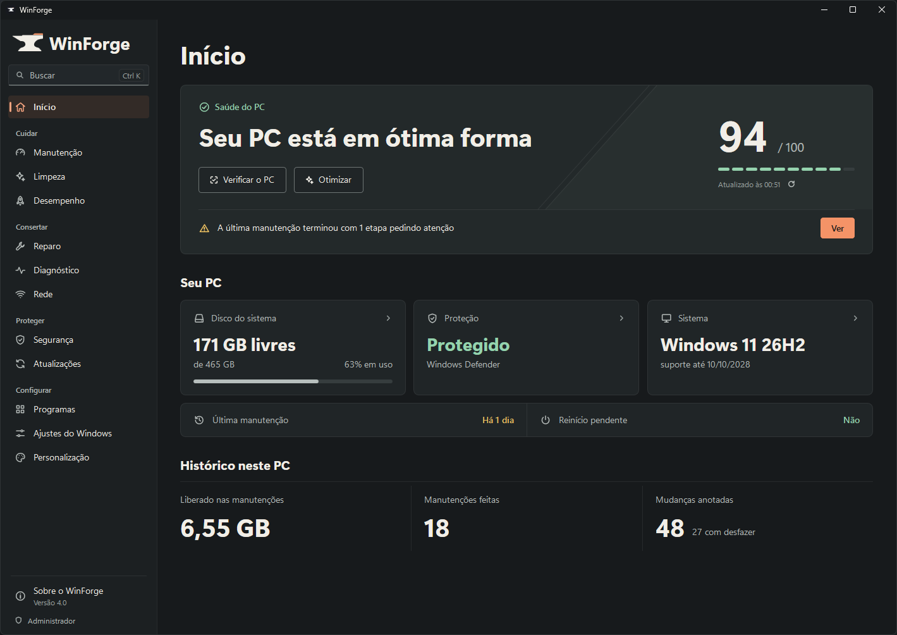

<p align="center">
  
</p>

# WinForge

[](https://github.com/guilhermehenn/winforge/releases/latest)
[](LICENSE)
[](#requisitos)
[](#requisitos)

**Português** · [English](README.en.md) · [Español](README.es.md)

Cuide do seu PC com Windows num lugar só: o WinForge limpa, repara, atualiza e avisa antes do problema, numa janela simples ou, para quem prefere, num menu no terminal. Ele pergunta antes do que tem peso e guarda como as coisas eram, para você poder voltar atrás.

[Site](https://usewinforge.com.br) · [**Baixar o WinForge**](https://github.com/guilhermehenn/winforge/releases/latest/download/WinForge.zip) · [Todas as versões](https://github.com/guilhermehenn/winforge/releases) · [O que mudou](CHANGELOG.md)

<p align="center">
  
</p>

## Por que o WinForge

- **Tudo num lugar só:** limpeza, reparo do Windows, atualizações, rede, segurança, programas e ajustes, em quatro grupos: Cuidar, Consertar, Proteger e Configurar.
- **Sem sustos:** o que apaga ou mexe fundo no sistema pergunta antes. Cada ajuste guarda o valor original, e o **Otimizar** começa por um ponto de restauração.
- **Avisa antes do problema:** um ícone perto do relógio, opcional, avisa quando o disco enche ou dá sinais de falha, a proteção desliga ou falta manutenção.
- **Usa o próprio Windows:** Windows Update, Microsoft Defender, DISM, SFC, CHKDSK e winget, sem "aceleradores" de outra empresa.
- **Seus dados ficam no PC:** sem conta e sem telemetria.

## Começar

1. Baixe o **WinForge.zip** e extraia a pasta inteira (botão direito > **Extrair tudo**).
2. Abra o **WinForge-Setup.cmd** e aceite o pedido de Administrador do Windows. O WinForge fica no Menu Iniciar e em **Configurações > Aplicativos**.
3. Abra o WinForge. No **Início**, a nota de saúde diz como o PC está, e dois botões cuidam do resto:
   - **Verificar o PC** confere o PC em 11 etapas e corrige num clique o que é seguro;
   - **Otimizar** faz a manutenção completa, em 20 etapas: as perguntas vêm no começo, e depois ele segue sozinho. Pode passar de uma hora.

Prefere sem instalar? Abra o **WinForge.cmd** direto da pasta extraída.

## O que ele faz

| Grupo | Páginas | Por exemplo |
|---|---|---|
| **Cuidar** | Manutenção, Limpeza, Desempenho | Limpeza rápida, análise do espaço, arquivos duplicados, o que abre com o Windows, manutenção agendada |
| **Consertar** | Reparo, Diagnóstico, Rede | Reparar o Windows (DISM + SFC), CHKDSK, telas azuis com a causa provável, teste de memória, saúde dos discos, reparo da rede e do DNS, a impressão travada |
| **Proteger** | Segurança, Atualizações | Estado da proteção, auditoria de segurança, chave de recuperação do BitLocker, atualizações do Windows, drivers e programas |
| **Configurar** | Programas, Ajustes do Windows, Personalização | Instalar e desinstalar programas, backup antes de formatar, 53 ajustes do Windows com perfis prontos |

E também:

- **Monitor na bandeja** (opcional): avisa antes do problema, e o clique no aviso abre a ação certa.
- **Histórico de mudanças** (em Manutenção): o que o WinForge mudou no PC, com o desfazer do que tem volta.
- **Três idiomas:** português, inglês e espanhol, seguindo o idioma do Windows (a escolha fica em **Sobre o WinForge > Idioma**).

## Requisitos

- Windows 10 ou 11, com o Windows PowerShell 5.1 que já vem nele.
- A permissão de Administrador para boa parte das ações. O WinForge abre pedindo; sem ela, abre assim mesmo e pede de novo quando uma ação precisa.
- O Instalador de Aplicativo (winget) para instalar, atualizar e desinstalar programas. Ele vem com o Windows; se faltar, o WinForge oferece repará-lo.
- Internet só para o que depende dela: as atualizações, os programas, os testes de rede e a busca de uma versão nova.

## Segurança e privacidade

> [!IMPORTANT]
> Os scripts não são assinados digitalmente, e o Windows pode avisar ao abrir. Baixe só da [página de versões](https://github.com/guilhermehenn/winforge/releases) e, se quiser, confira o zip no PowerShell: o resultado deve ser igual ao SHA-256 publicado na página da versão.
>
> ```powershell
> Get-FileHash .\WinForge.zip -Algorithm SHA256
> ```

- **Nada do seu PC é enviado.** O WinForge só vai à internet para procurar uma versão nova e baixar a lista de programas e as datas de suporte do Windows (no GitHub), e nos testes de rede que você pede (velocidade, conectividade e IP público). O resto passa pelas ferramentas do Windows e dos programas: Windows Update, Microsoft Defender, winget, Microsoft Store e os atualizadores dos navegadores.
- **Nem tudo tem volta:** o que a limpeza apaga e os programas desinstalados não voltam pelo WinForge. Por isso ele pergunta antes.
- **Os dados do WinForge** (logs, relatórios e históricos) ficam em `%LOCALAPPDATA%\WinForge`. O backup antes de formatar não copia seus arquivos pessoais e guarda as senhas do Wi-Fi em texto: proteja o backup.

## Atualizar e desinstalar

- **Atualizar:** **Sobre o WinForge > Verificar nova versão** baixa a versão nova, confere o SHA-256 e instala com um clique; o WinForge fecha e abre de novo já atualizado. Se algo falhar no meio, os arquivos anteriores voltam. Com o monitor na bandeja ligado, o WinForge avisa quando sai uma versão nova. Vale da 4.0 em diante: de uma versão anterior, instale a 4.0 pelo **WinForge-Setup.cmd**.
- **Desinstalar:** por **Configurações > Aplicativos**, ou abrindo o **WinForge-Setup.cmd** da pasta instalada. Ele pergunta se apaga também os dados em `%LOCALAPPDATA%\WinForge`. Os ajustes do Windows continuam como estão: para voltar ao que era, use antes **Ajustes do Windows > Desfazer ajustes do WinForge**.

## Linha de comando

```powershell
.\WinForge-Console.cmd                      # menu no terminal
.\WinForge-Console.cmd -Action Check -Json  # verificação rápida, em JSON
.\WinForge-Console.cmd -Action Report       # relatório HTML e texto
.\WinForge-Console.cmd -Language en         # pt, en ou es
```

A verificação rápida não pede Administrador e diz o resultado no código de saída: 0 tudo em dia, 1 pontos de atenção, 2 algo crítico, 3 não foi possível avaliar.

## Perguntas frequentes

<details>
<summary><strong>O WinForge deixa o PC mais rápido?</strong></summary>

Ele tira o que pesa sem necessidade (temporários, o que abre com o Windows, programas pesando agora), repara o Windows e mantém tudo em dia. Não promete um número de velocidade: o ganho depende de como o PC estava.
</details>

<details>
<summary><strong>Ele substitui o antivírus?</strong></summary>

Não. A segurança do WinForge usa o Microsoft Defender do próprio Windows: confere a proteção, atualiza as assinaturas e roda a verificação. Com outro antivírus instalado, as ações do Defender ficam de fora.
</details>

<details>
<summary><strong>Mudou algo que eu não queria. Como volto?</strong></summary>

Em **Manutenção > Histórico de mudanças**, cada mudança que tem volta tem o desfazer. Para os ajustes do Windows de uma vez, **Ajustes do Windows > Desfazer ajustes do WinForge**. E o ponto de restauração que o Otimizar cria no começo volta o sistema pela Restauração do Sistema do Windows.
</details>

<details>
<summary><strong>Funciona sem internet?</strong></summary>

A limpeza, o diagnóstico, os ajustes e boa parte dos reparos, sim. As atualizações, os programas, os testes de rede e a busca de uma versão nova precisam de internet.
</details>

<details>
<summary><strong>Por que ele pede Administrador?</strong></summary>

Reparar o Windows, instalar atualizações e mudar ajustes do sistema exigem essa permissão. Se você recusar, o WinForge abre assim mesmo, e as ações que precisam dela mostram o escudo e pedem de novo.
</details>

## Ajuda

Achou um problema ou tem uma sugestão? [Abra uma issue](https://github.com/guilhermehenn/winforge/issues/new). Para ajudar na análise de um problema, informe:

- A versão do WinForge e a versão e build do Windows.
- A interface usada: janela ou terminal.
- A função executada e os passos para reproduzir o problema.
- O resultado esperado e o que aconteceu.
- A mensagem de erro completa ou uma captura de tela.

**Sobre o WinForge > Pacote de suporte** reúne os logs, a verificação rápida e o último relatório em um zip. Antes de compartilhar logs, relatórios ou o pacote, confira o conteúdo e remova informações pessoais.

**Achou uma falha de segurança?** Não abra uma issue pública: siga a [política de segurança](https://github.com/guilhermehenn/winforge/security/policy) e use **Report a vulnerability**, que chega só ao mantenedor.

## Para quem desenvolve

- [Documentação técnica](https://github.com/guilhermehenn/winforge/blob/main/docs/documentacao-tecnica-4.0.md): como o WinForge é feito, onde fica cada coisa e como mudar o código. Quem chega agora começa por "Comece por aqui".
- [Índice da documentação](https://github.com/guilhermehenn/winforge/blob/main/docs/README.md): o mapa de funcionalidades e a documentação técnica.
- `modules/`: as funções; `gui/`: a janela; `lang/`: as traduções (gettext); `tools/`: assinatura, o zip da versão e traduções.
- [O que mudou em cada versão](CHANGELOG.md) e o [guia detalhado da build 3.69](https://github.com/guilhermehenn/winforge/blob/v3.69.0/README.md) (arquivado).

## Licença

[GNU GPLv3](LICENSE) · © 2026 [Guilherme Henn](https://github.com/guilhermehenn), que mantém o WinForge.
